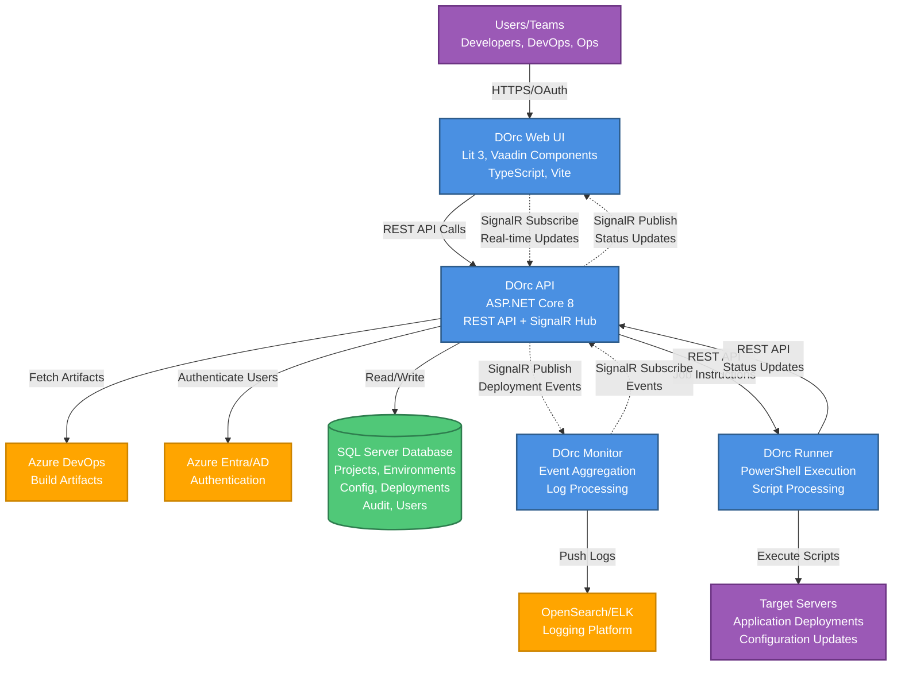

# DOrc (DevOps Orchestrator)

## Description

DOrc is a DevOps deployment orchestration engine designed for managing and executing PowerShell-based deployments across multiple environments. It provides centralized configuration management, environment control, and deployment workflow automation.

## Architecture Overview

DOrc consists of four main components working together to orchestrate deployments:



### Component Details

- **DOrc API** - ASP.NET Core 8 REST API that manages deployments, environments, and configuration
- **DOrc Web UI** - Modern web interface built with Lit 3 and Vaadin components
- **DOrc Runner** - Agent service that executes PowerShell deployment scripts on target servers
- **DOrc Monitor** - Service for monitoring and logging deployment activities

### Data Flow

1. **User Interaction**: Users interact with the Web UI to initiate deployments, manage environments, and configure projects
2. **API Processing**: The API receives requests, validates permissions, and orchestrates deployment workflows
3. **Job Execution**: The API communicates with Runner agents on target servers to execute PowerShell scripts
4. **Real-time Updates**: SignalR pushes deployment status updates to the Web UI and Monitor service
5. **Monitoring & Logging**: The Monitor service aggregates events and logs for observability

## Getting Started

### Prerequisites

**Backend Requirements:**
* .NET 8 SDK (for API and services)
* .NET Framework 4.8 SDK (for legacy PowerShell runner components)
* SQL Server (for database)
* WiX Toolset 5 (for creating installers)

**Frontend Requirements:**
* Node.js >= 14.0.0
* npm >= 7.0.0

### Installation

#### 1. Clone the Repository

```bash
git clone https://github.com/sefe/dorc.git
cd dorc
```

#### 2. Build the Backend

Open the solution in Visual Studio:

```bash
cd src
# Open Dorc.sln in Visual Studio 2022 or later
```

Build the solution to restore NuGet packages and compile all projects.

#### 3. Build the Frontend

```bash
cd src/dorc-web
npm install
npm run build
```

#### 4. Database Setup

Run database migrations and setup scripts (details in `src/Dorc.Database/`).

#### 5. Installation Package (Optional)

To create an installation package:

```bash
cd src/install-scripts
# Run the appropriate installation script
```

### Development Setup

#### Running the API

1. Set `Dorc.Api` as the startup project in Visual Studio
2. Update `appsettings.Development.json` with your database connection string
3. Press F5 to run in debug mode

The API will start on `https://localhost:5001` (or configured port).

#### Running the Web UI

```bash
cd src/dorc-web
npm run dev
```

The web application will be available at `http://localhost:8888`.

### Update Client Libraries

The project uses OpenAPI Generator to create client libraries from API
specifications. CI regenerates the TypeScript clients on every build and
fails if the committed code differs from the generator output, so specs and
clients must always be committed together.

From the `src/dorc-web` directory:

```bash
npm run api-gen             # regenerate both clients from the committed specs
npm run dorc-api-gen        # DOrc API TypeScript client (from src/apis/dorc-api/swagger.json)
npm run ado-build-csharp-gen # Azure DevOps Build C# client (from src/Dorc.AzureDevOps/build.json)
```

When a C# controller or API model changes, update
`src/dorc-web/src/apis/dorc-api/swagger.json` to match (a running API serves
the document at `/swagger/v1/swagger.json`) and regenerate. Every generated
tree is pure generator output — app concerns live alongside, not inside:

- Web: base URL and OAuth tokens are supplied through the generated
  `Configuration` class from
  `src/dorc-web/src/services/dorc-api-configuration.ts`. See
  [src/dorc-web/README.md](src/dorc-web/README.md).
- C# (`src/Dorc.AzureDevOps`, consumed by `Dorc.Core`, the Monitor and the
  TerraformRunner for build numbers and artifact locations): AAD token
  generation and the count/value list-envelope handling live in the
  `Dorc.AzureDevOps.Client` project, wired in through the generated
  `Configuration`/`ApiClient` classes. The client csproj is dependabot-owned
  and excluded from generation via that tree's `.openapi-generator-ignore`.

The Azure DevOps Build spec is authoritative at
[MicrosoftDocs/vsts-rest-api-specs](https://github.com/MicrosoftDocs/vsts-rest-api-specs)
(`specification/build/6.0/build.json`). Generation itself reads only the
committed `src/Dorc.AzureDevOps/build.json`, so builds are hermetic and an
upstream change can never turn an unrelated pull request red. The
`ado-build-spec-refresh` workflow owns adopting upstream: it runs weekly (and
on demand), fetches the official document, regenerates, and opens a pull
request when anything changed. To do it by hand:

```bash
npm run ado-build-spec-refresh   # update the committed build.json from upstream
npm run api-gen                  # regenerate against it
```

### Database access management (side-by-side pilot)

The **Database Access** dialog manages database-native users, directory-backed
database principals, roles and role memberships. Open it with **Manage Database
Access** on the environment's Databases tab; the button is only shown to
environment owners and administrators. It does not replace the legacy Users or
Permissions controls yet.
Work is tracked by #945 and its children #946-#953.

The dialog prepares access in DOrc only: import legacy assignments or review/edit
saved desired state. No target connection or target-readiness check occurs.
Target preview and apply are performed by the CLI / deploy module through the API,
not from this UI.

For migration, expand **Import legacy Endur / SQL users** and select **Load legacy
access**. The guided review reads DOrc's existing assignments and suggests same-name
role mappings without connecting to the target database. Choose or enter a role name;
suggestions come from legacy permissions and saved desired roles, not observed SQL roles.
Saved Windows identity bindings in DOrc are verified against the live directory.
Other Windows accounts are automatically resolved from their exact `DOMAIN\account`
name to a SID, then verified against live AD, including user/group type and active
user status. This does not query SQL or use fuzzy display-name matching. Saved
bindings are not replaced automatically if an account name has been reused.
Account names and existing permissions are shown together; failed automatic lookups
remain visible and require an explicit directory search/selection or a deliberate
**Exclude from migration** choice. Unqualified account names require manual selection.
Automatic matching does not approve `db_owner` memberships or save the import.
**Choose identity** brings the directory picker below the account list into view
and focuses its search field. Search, select the intended result, then use
**Use selected identity** to verify and record the mapping.
Exclusion is available for unresolved Windows accounts not already in desired
state. It skips all of that account's assignments in this import, without deleting
legacy records, removing existing SQL access, or managing the excluded account.
Use **Include in migration** to undo a selection. Loading and previewing do not save configuration or change
SQL permissions.

Review the role dropdowns and account mappings, then select **Preview legacy
import** after any edits. Validation errors are shown once per message with
account names; protected roles and unresolved accounts that have not been explicitly
excluded still block import. Excluded names, permissions and assignment counts are
shown separately in the preview, included in the confirmation, and recorded in the
import audit. Changes to exclusions invalidate the preview just like mapping edits.
The API must be updated alongside the UI to support exclusions; the UI refuses to
import if the API does not acknowledge them. **Import confirmed preview** requires confirmation and saves
only DOrc desired state. Loading, import preview and confirmed import do not perform
target discovery or validate target connectivity, logins, roles or SQL permissions.
Source consistency, directory identity, privileged approval and stale-preview checks
still apply. A successful import means **metadata migrated**, not **target access verified**.
SQL reconciliation remains a separate preview/apply operation outside this dialog. **Advanced: generated import JSON** uses the standard
`hegs-json-viewer` for inspecting generated mappings and the proposed configuration;
users do not need to write JSON. Reloading legacy access replaces unsaved mapping
selections, including exclusions. Exclusions apply only to the confirmed import,
not to future imports or legacy deployment jobs.

For a legacy permission mapped to `db_owner`, an owner or administrator of **every
environment sharing the database** must explicitly tick **Approve db_owner** for
each intended account. No accounts are approved automatically. The preview and
confirmation identify these full-database-control memberships; import records the
approving actor, time, account identities and approvals in its audit. Changing
mappings or identities clears unsubmitted approvals and requires a fresh preview.
Ordinary environment Modify access alone cannot approve a new privileged membership.

Approved memberships are persisted in the existing desired-state records; subsequent
reconciliation can grant or restore them, including after a database restore. An
unchanged reimport retains existing approvals. Ordinary desired-state editing can
revoke membership, but cannot grant/re-enable `db_owner` or change its approved
login identity; granting or re-enabling requires explicit legacy-import approval.
This adds no configuration switch or schema migration. Import still changes only
DOrc metadata, and SQL Apply still requires separate confirmation.

Deploy the updated database project before enabling the feature. It adds
`DatabaseAccessConfiguration`, `DatabaseAccessPrincipal`, `DatabaseAccessRole`,
`DatabaseAccessMembership` and `DatabaseAccessAudit` in the `deploy` schema; it does not alter or import
`USERS`, `ENVIRONMENT_USER_MAP` or `PERMISSION`. The provider is stored separately
from `DATABASE.DB_Type`, which remains an application-tag field.

For installations with these tables in `dbo`, the database project's refactor log
moves the existing tables into `deploy` rather than dropping and recreating them.
Retain the refactor log when building/publishing the DACPAC so existing desired
state and audit history are preserved. Take the API offline during the coordinated
schema/API upgrade: the old API uses `dbo`, while the updated API uses `deploy`.
SQL Server schema transfers remove explicit object-level permissions. Capture
custom grants/denies before upgrading, reapply the required permissions afterward,
and verify the API identity has the required access to `deploy` before bringing
the API back online. This upgrade affects only the DOrc metadata database, not any
managed target environment.

The API defaults to:

```json
"DatabaseAccess": {
  "Enabled": true
}
```

`DatabaseAccess:Enabled` is the only rollout setting. The feature defaults to enabled
even if the setting is omitted, including Apply, for all databases the caller is
authorized to manage. Set it to `false` to disable new requests to this feature.
There is no per-database allowlist or separate execution switch. Remove the obsolete
`DatabaseAccess:DatabaseIds` and `DatabaseAccess:ExecutionEnabled` settings from
existing API configuration; they are ignored. **Upgrading an API with `Enabled=true`
therefore enables the feature for previously unlisted databases and enables Apply
even if the old execution setting was false.** It does not import or apply anything
automatically. The status response retains `ExecutionEnabled` for client compatibility,
but its value always equals `Enabled`.

If the panel reports that database access management is disabled, a DOrc administrator
must remove the explicit `DatabaseAccess:Enabled=false` override or set it to `true`
in the API configuration. This is a feature
setting, not a SQL permission error; the existing Users and Permissions controls
remain available. The feature uses new
`DatabaseAccess/{envId}/{databaseId}` endpoints, not the legacy user contracts.
Access requires environment modification rights; changes and target discovery
also require rights on every environment sharing the database.

The first provider is `sql-server`. Additional engines require an
`IDatabaseAccessProvider` registration; unsupported providers fail explicitly.
The initial SQL Server capability includes database-user creation/remapping/
removal against **existing server logins**, custom-role creation/removal, and
role membership changes. It does not provision server logins or passwords,
manage object-level grants, or modify protected/system principals and roles.
`public`, `db_securityadmin` and `db_accessadmin` remain blocked. The `db_owner`
role definition is protected: it may only be referenced, never created, altered
or deleted by DOrc. Only its explicitly approved imported memberships can be managed.
Reference-only roles must exist before reconciliation, but their existence is not
checked during metadata import. Only explicitly managed absent
principals/roles are removed; objects found through discovery are not adopted
or deleted implicitly.

Target preview and Apply (not metadata import) use the API process's Windows identity with `Encrypt=true`
and `TrustServerCertificate=true` to support SQL Server instances without
CA-trusted certificates. Traffic remains encrypted, but the server certificate's
trust chain and hostname are not validated. Grant only the permissions needed:
`VIEW DEFINITION` for discovery, sufficient server-login metadata visibility,
and membership in `db_owner` on the target database. SQL Server requires
database-owner-level authority for orphaned-user remapping and changing fixed
database-role membership, so `ALTER ANY USER`/`ALTER ANY ROLE` alone are not
sufficient. Do not grant
`sysadmin` merely to enable this feature. Existing AD users/groups are resolved
through the AD searcher; the new principal records store stable SID references
and database aliases, not directory profile copies. Deleted identities and
directory outages are reported, not treated as successful empty lookups.

**CLI and deployment-module integration**

The updated generic `Tools.ApplyPermissionsCLI` in `dorc-cli` consumes this API
using `/permissions:DatabaseAccess`, `/environment:<name>`, `/instance:<server>`
and `/database:<name>`. Add `/preview:true` for discovery without apply. It resolves
the exact attached database, checks feature/execution status, previews, and applies
that token without retries or a legacy fallback. Machine-to-machine audit entries
use the authenticated client identity through DOrc's shared claims reader.

The updated `sefe/dorc-ps-deploy-module` exposes
`Apply-DatabasePermissions -permissionSource DatabaseAccess -previewOnly`.
The deployment property `DatabasePermissionsMode=DatabaseAccess` opts existing
callers into the new mode for migrated environments. The wrapper requires the
new generic CLI's embedded protocol marker, preserves the pre-apply permissions
backup, passes the environment and API URL, and stops on CLI failure. Production
applies remain additive-only.

Deploy the schema/API, generic CLI and PowerShell module together before opting
in. API service-account SQL rights are required for target preview and Apply even
when the deployment runner already has SQL access; they are not prerequisites for
metadata import. Do not project this state onto the legacy permission-list
endpoint or run a legacy reset on a migrated database: the old non-production
CLI deletes users rather than reconciling only managed objects. Endur, Arc and
ComOps in-application permissions remain on their existing dedicated paths;
DatabaseAccess is not a replacement for those workflows.

**Migration procedure**

1. Deploy the schema before upgrading the API; the feature is enabled by default
   globally, including Apply. Restrict the rollout operationally to
   approved targets using existing environment permissions and deployment jobs.
2. Open the new panel and select **Load legacy access**. Review the suggested role
   mappings and verified directory identities. Resolve reported conflicts or
   explicitly exclude unresolved Windows accounts, then preview the import.
3. Confirm the import into desired state. `Endur` and `Sql` accounts become
   native principal definitions in DOrc. No legacy or target data is changed, and
   target readiness is not checked.
4. Review desired principals/roles and run **Discover and preview target
   changes**. Review the operations, observed state and errors. Desired edits,
   legacy edits and target changes invalidate applicable previews.
5. After operational approval, apply the confirmed
   preview. SQL Server changes run in one transaction; failures roll back.
   A database-scoped DOrc lock serializes changes across API instances.
6. Inspect recent audit records, remaining drift and import divergence.
   Repeating the same import does not duplicate data. Later legacy edits are
   not dual-written; removed/remapped assignments are reported for explicit
   resolution. An audit left `Started` or `FailedOrUncertain` requires target
   rediscovery before retrying, especially following a connection/process failure.

Setting `DatabaseAccess:Enabled=false` blocks new requests to the new stack
(apart from its authorized status response), including target mutations. It does
not cancel in-flight transactions or revert committed changes or legacy data.
Back up the new metadata
before maintenance; configured databases have protective foreign keys and
cannot be deleted while their configuration remains. Keep the legacy stack
available until the Endur team signs off, migration conflicts and drift are
resolved, and an agreed observation period shows no remaining legacy usage.
Production rollout (#952) and removal (#953) are separate operator-approved
changes. This implementation does not migrate external deployment scripts or
post-restore consumers automatically; inventory and migrate those consumers
before legacy decommissioning.

For isolated SQL integration coverage on Windows:

```powershell
SqlLocalDB create DOrcAccessTests -s
$env:DORC_ACCESS_TEST_SERVER = '(localdb)\DOrcAccessTests'
dotnet test .\src\Dorc.Core.Tests\Dorc.Core.Tests.csproj --configuration Release --filter FullyQualifiedName~DatabaseAccess
```

The SQL test accepts only that named LocalDB instance, creates randomly named
test databases/logins, and removes them in cleanup. Never point tests at a
shared production database.

## Project Structure

```
dorc/
├── src/
│   ├── Dorc.Api/              # Main REST API
│   ├── Dorc.Api.Client/       # API client library
│   ├── Dorc.ApiModel/         # Shared API models
│   ├── Dorc.Core/             # Core business logic
│   ├── Dorc.Database/         # Database migrations and setup
│   ├── Dorc.Monitor/          # Deployment monitoring service
│   ├── Dorc.Runner/           # PowerShell execution agent
│   ├── Dorc.PowerShell/       # PowerShell integration
│   ├── Dorc.PersistentData/   # Data access layer
│   ├── Dorc.AzureDevOps/      # Azure DevOps integration
│   ├── dorc-web/              # Web UI (see below)
│   └── install-scripts/       # Installation helpers
├── CONTRIBUTING.md
├── LICENSE.md
└── README.md
```

### Web UI Structure

See [src/dorc-web/README.md](src/dorc-web/README.md) for detailed frontend documentation.

## Technology Stack

**Backend:**
- .NET 8 / ASP.NET Core
- .NET Framework 4.8 (legacy components)
- Entity Framework Core
- SignalR (real-time updates)
- Log4net

**Frontend:**
- Lit 3 (Web Components)
- Vaadin Components 24
- Vite (build tool)
- TypeScript
- RxJS

**Testing:**
- xUnit / NUnit
- K6 (load testing)

## Development Workflow

1. Make changes to backend code in Visual Studio
2. Make changes to frontend code in your preferred editor
3. Test locally using `npm run dev` for frontend and F5 in Visual Studio for backend
4. Run linting: `npm run format` (frontend)
5. Build: `npm run build` (frontend), Build Solution (backend)
6. Commit and push changes
7. Create pull request

## Testing

### Frontend Testing

```bash
cd src/dorc-web
npm test
```

### Load Testing with K6

```bash
cd src/dorc-web/k6-tests
k6 run monitor-request-page-test.js
```

See [src/dorc-web/README.md](src/dorc-web/README.md) for more K6 testing details.

## Contributions

SEFE welcomes contributions into this solution; please refer to the CONTRIBUTING.md file for details

## Authors

The solution is designed and built by SEFE Securing Energy for Europe Gmbh.

SEFE - [Visit us online](https://www.sefe.eu/)

## License

This project is licensed under the [Apache 2.0] License - see the LICENSE-2.0.txt file for details
